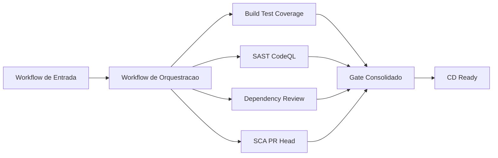

# 02. Arquitetura da Pipeline

## Fluxo macro

## Principio de desenho

- controles executados como componentes reutilizaveis;
- outputs padronizados entre jobs;
- decisao final centralizada no gate;
- rastreabilidade por sumario de execucao.

## Beneficios arquiteturais

- padrao unico para equipes diferentes;
- manutencao simplificada por encapsulamento;
- escalabilidade com novos controles sem quebrar o fluxo base.
